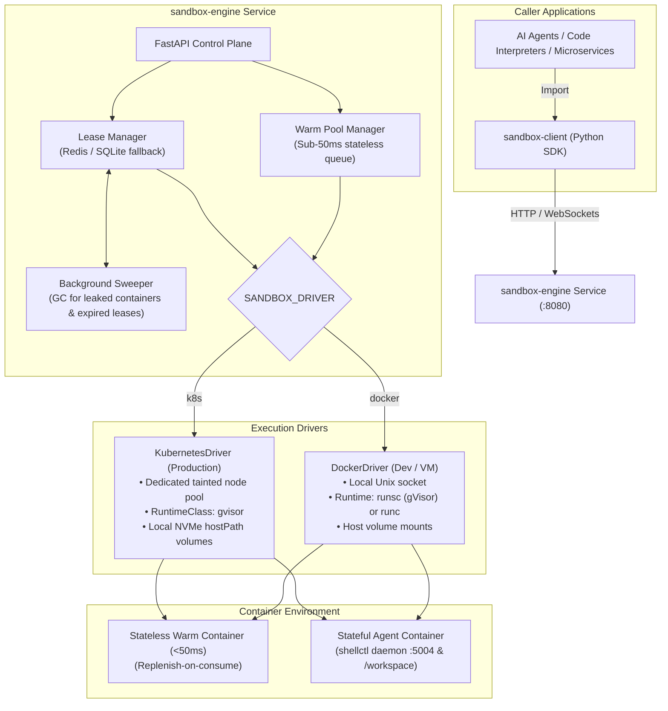

# Sandbox Execution System

A high-performance, security-hardened execution platform for **stateless code execution (<50ms latency)** and **stateful AI agent sandboxes (persistent workspaces, real-time streaming exec, and interactive PTY terminals)**.

Designed with a **Pluggable Driver Architecture** supporting both **Docker** (local dev & single VMs) and **Kubernetes** (cloud-native production clusters) via a single environment variable:
```bash
export SANDBOX_DRIVER=docker  # or 'k8s'
```

---

## Architecture Overview



---

## Repository Structure

```text
sandbox-execution-system/
├── product-details.md             # Full architectural specification
│
├── daemon/                        # In-sandbox execution kernel
│   ├── go.mod                     # Go 1.22 static binary (<8MB RAM)
│   ├── main.go                    # shellctl server listening on :5004
│   ├── Dockerfile                 # Multi-stage container base image
│   ├── test_daemon.py             # Standalone daemon verification suite
│   ├── runner/python_runner.py    # Sub-50ms stateless code runner
│   └── handlers/                  # Health, Execute, Exec, PTY, and FS APIs
│
├── sandbox-engine/                # FastAPI Control Plane
│   ├── pyproject.toml
│   ├── src/sandbox_engine/
│   │   ├── config.py              # Settings (SANDBOX_DRIVER, REDIS_URL, etc.)
│   │   ├── models.py              # Pydantic schemas for requests & leases
│   │   ├── drivers/               # Pluggable Docker & Kubernetes drivers
│   │   ├── core/                  # WarmPoolManager, LeaseManager, Sweeper
│   │   ├── api/                   # REST routes & WebSocket PTY proxy
│   │   └── main.py                # FastAPI app with async lifespan
│   └── tests/                     # Benchmarks & stateful test suites
│
├── sandbox-client/                # Async Python SDK
│   ├── pyproject.toml
│   ├── src/sandbox_client/
│   │   ├── client.py              # SandboxClient entrypoint
│   │   ├── session.py             # SandboxSession context manager
│   │   ├── fs.py                  # FileSystemClient
│   │   ├── terminal.py            # Interactive PTY WebSocket client
│   │   └── adapters/agent_tools.py# Pre-built tools for Pydantic AI
│   └── tests/                     # Full E2E integration test suite
│
└── deploy/                        # Deployment manifests
    ├── docker-compose.yml         # Local stack (Engine + Redis + Squid)
    └── squid/                     # SSRF egress proxy (blocks 169.254, RFC1918)
```

---

## Quickstart & Usage

### 1. Build the Base Container Image
```bash
docker build -t sandbox-base:latest daemon/
```

### 2. Install the Client SDK
```bash
pip install -e sandbox-client
```

---

### Python SDK Usage Examples

#### Example 1: Stateless Code Execution (Code Interpreter / Function Calls)
Runs against pre-warmed containers with **`< 50ms` execution latency**:
```python
from sandbox_client import SandboxClient

async with SandboxClient(base_url="http://localhost:8080") as client:
    result = await client.run_code(
        language="python",
        code="""
def main(inputs):
    return {"doubled": inputs["value"] * 2}
""",
        inputs={"value": 21},
        timeout=5.0
    )

print(result.output)      # {'doubled': 42}
print(result.duration_ms) # ~16ms!
```

#### Example 2: Stateful OS Sandbox for Autonomous Agents
```python
from sandbox_client import SandboxClient

async with SandboxClient(base_url="http://localhost:8080") as client:
    # Acquire a persistent workspace session with automatic lease renewal
    async with client.acquire_session(workspace_id="repo_user_123", ttl_seconds=300) as session:
        # 1. Write source files into /workspace
        await session.fs.write("calc.py", "def add(a, b): return a + b\n")
        await session.fs.write("test_calc.py", "from calc import add\ndef test_add(): assert add(2, 3) == 5\n")

        # 2. Run shell commands with real-time streaming output
        async for chunk in session.exec_stream("pytest test_calc.py"):
            print(chunk.text, end="")

        # 3. Interactive PTY terminal (full bash session)
        pty = await session.terminal.open(cols=100, rows=30)
        await pty.send("git status\n")
        output = await pty.recv(timeout=2.0)
        print(output)
        await pty.close()
```

#### Example 3: Agent Tools for Pydantic AI
```python
from pydantic_ai import Agent
from sandbox_client import SandboxClient, create_agent_tools

async with SandboxClient(base_url="http://localhost:8080") as client:
    async with client.acquire_session(workspace_id="agent_repo") as session:
        tools = create_agent_tools(session)
        # Register tools with your agent:
        # agent = Agent('openai:gpt-4o', tools=[tools['bash'], tools['write_file'], tools['read_file'], tools['list_files']])
```

---

## Running the Verification Test Suites

Every part is independently testable:

```bash
# In-Sandbox Daemon & Base Image
python3 daemon/test_daemon.py

# Warm Pool Stateless Benchmark (<50ms SLA)
cd sandbox-engine && PYTHONPATH=src python3 tests/test_stateless_bench.py

# Stateful Workspace Persistence & Sweeper GC
cd sandbox-engine && PYTHONPATH=src python3 tests/test_stateful_suite.py

# Full End-to-End Integration Suite
PYTHONPATH="sandbox-engine/src:sandbox-client/src" python3 sandbox-client/tests/test_e2e.py
```
