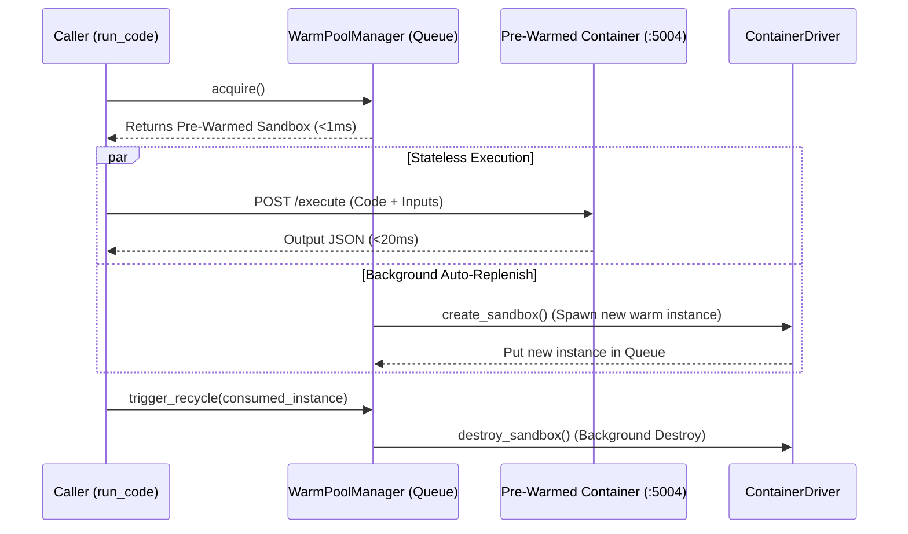

# Architecture & Pluggable Drivers

The **Sandbox Execution System** uses an abstracted driver architecture that allows the exact same application to run on a local developer's laptop, a single cloud VM, or a large Kubernetes cluster without code changes.

---

## 1. The `ContainerDriver` Interface

All container operations are decoupled behind a unified abstract interface:

```python
class ContainerDriver(ABC):
    @abstractmethod
    async def create_sandbox(self, spec: SandboxSpec) -> SandboxInstance:
        """Create and start a container or Pod, returning its instance info and direct IP:port endpoint."""
        pass

    @abstractmethod
    async def destroy_sandbox(self, sandbox_id: str) -> None:
        """Gracefully and forcefully destroy a container/Pod."""
        pass

    @abstractmethod
    async def get_sandbox_endpoint(self, sandbox_id: str) -> str:
        """Get the direct HTTP URL (e.g. http://<ip>:5004) for the sandbox."""
        pass

    @abstractmethod
    async def list_sandboxes(self, labels: Dict[str, str] = None) -> List[SandboxInstance]:
        """List active sandboxes matching labels for reconciliation."""
        pass

    @abstractmethod
    async def healthcheck(self, endpoint: str) -> bool:
        """Probe the sandbox's shellctl /health endpoint."""
        pass
```

---

## 2. Driver Implementations

### A. `DockerDriver` (Development & Single Host)
* **Target Environment:** Local macOS Docker Desktop, Linux developers, and single-node servers.
* **Mechanism:** Interacts with the Docker daemon over the Unix socket (`/var/run/docker.sock` or `~/.docker/run/docker.sock`).
* **Dynamic Ephemeral Port Binding:** Automatically binds `5004/tcp` to `127.0.0.1:0`. The OS assigns a random available host port, preventing port collisions across concurrent sandboxes.
* **Storage:** Mounts host directories directly into `/workspace`.
* **Runtime:** Configurable via `SANDBOX_DOCKER_RUNTIME`. Supports `runsc` (gVisor) on Linux, with automatic fallback to `runc` on macOS.

---

### B. `KubernetesDriver` (Production Cloud Clusters)
* **Target Environment:** EKS, GKE, AKS, or bare-metal Kubernetes clusters.
* **Mechanism:** Manages Pods using `kubernetes_asyncio`.
* **Tainted Node Pool Isolation:** Pods are scheduled strictly onto dedicated nodes tainted with `sandbox=true:NoSchedule` via matching tolerations and `nodeSelector`.
* **gVisor RuntimeClass:** Pods specify `runtimeClassName: gvisor` to ensure userspace kernel protection.
* **Bypassing the K8s API Server (`<15ms` Network Dispatch):**
  * Traditional tools route commands through `kubectl exec` / `pods/exec`, which proxies through `kube-apiserver` and adds 150–300ms of latency.
  * `KubernetesDriver` retrieves the Pod's direct IP on the cluster CNI (Calico/Cilium) and communicates **directly with `http://<pod-ip>:5004`**, reducing network hops to `< 5ms`.
* **Instant Local NVMe Storage (Zero CSI Delay):**
  * Avoids cloud CSI block storage (EBS/GPD) attach/detach delays (which take 15–45 seconds).
  * Uses fast node-local storage (`local-path-provisioner` or `hostPath`), enabling 0-millisecond mount latencies when agent sessions resume.

---

## 3. Warm Pool Architecture ("Replenish-on-Consume")

To achieve **`< 50ms` execution latency** without container boot penalties, the `WarmPoolManager` maintains a pool of pre-running sandboxes in memory:



1. **Acquire `< 1ms`:** `pool.acquire()` pops a ready instance from the `asyncio.Queue`.
2. **Execute `< 20ms`:** Directly hits `http://<endpoint>/execute` in-memory.
3. **Background Replenish:** Asynchronously spawns a replacement container to restore target pool size without blocking the caller.
4. **Taint & Recycle:** The consumed container is marked tainted and destroyed asynchronously in the background.

---

## 4. Lease Manager & Sweeper (Stateful Agent Lifecycles)

### Lease Ledger (Redis + SQLite Fallback)
* **Redis:** In production, leases are tracked at `lease:session:{id}` with sliding TTLs.
* **SQLite Fallback:** If Redis is offline, the system transparently logs and falls back to a local SQLite database (`.sandbox_ledger.db`). Zero configuration needed for local dev.

### The Background Sweeper
An independent asyncio task running every 5 seconds:
1. **Reclaims Expired Leases:** Queries the ledger for sessions whose TTL has passed without a heartbeat ping. Calls `driver.destroy_sandbox()` to free RAM and ports.
2. **Preserves Disks:** The workspace directory (`/data/workspaces/{workspace_id}`) is kept intact on disk. When the agent reconnects later, the session instantly resumes with all files intact.
3. **Orphan Garbage Collection:** Detects and terminates any orphan containers in Docker/K8s that have no active lease record in the ledger.
