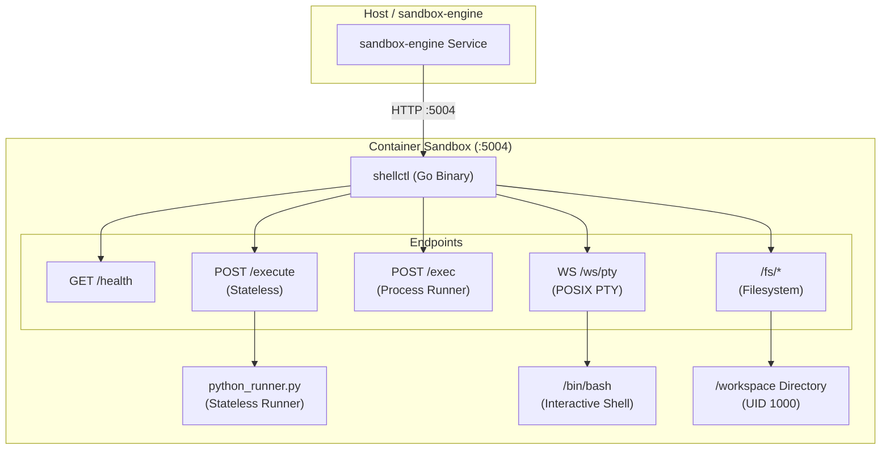

# In-Sandbox Daemon (`shellctl`)

`shellctl` is an ultra-lightweight, high-performance execution daemon compiled in Go that runs inside every container on port `5004`. It acts as the internal operating system agent for both stateless execution and interactive stateful agent sessions.

---

## 1. Why Go?

In traditional sandbox designs, daemons are often written in Python. This introduces severe engineering drawbacks:
* **RAM Overhead:** A Python daemon consumes 45–70 MB of RAM per container. `shellctl` consumes **`< 8 MB`**.
* **Startup Latency:** Python interpreter startup takes 150–300ms. `shellctl` starts in **`< 2 ms`**.
* **Environment Pollution:** A Python daemon shares the container's Python environment. When an autonomous agent runs `pip install` or upgrades packages, it can break the daemon's own dependencies. `shellctl` is a **single statically linked binary (`CGO_ENABLED=0`)** with zero runtime dependencies.

---

## 2. Daemon Architecture



---

## 3. Daemon Endpoints (Port `5004`)

### `GET /health`
Liveness and readiness check. Returns container uptime, Go version, and hostname.

### `POST /execute`
Sub-50ms stateless execution runner.
* Dispatches execution to `/opt/runner/python_runner.py`.
* Sends `{code, inputs}` via stdin; receives `{output, logs, exit_code}` via stdout.
* Enforces sub-millisecond process timeout via `syscall.Kill(-pid, syscall.SIGKILL)` on process groups.

### `POST /exec`
Stateful command execution for bash commands, test runners, git, and compilation.
* Supports **Buffered Mode** (`"stream": false`) returning full stdout/stderr JSON.
* Supports **Streaming Mode** (`"stream": true`) streaming chunks as `application/x-ndjson`.

### `GET /ws/pty`
Interactive POSIX Pseudo-Terminal (PTY) over WebSocket.
* Uses `creack/pty` to allocate `/dev/pts` device pairs.
* Emulates full `xterm-256color` terminal with ANSI escape codes and cursor manipulation.
* Accepts window resize events:
  ```json
  {"type": "resize", "cols": 120, "rows": 40}
  ```

### `/fs/write`, `/fs/read`, `/fs/list`, `/fs/delete`
Workspace filesystem APIs.
* **Security Guardrail:** Every path is validated with `filepath.Clean` and checked against the root `/workspace` directory. Any directory traversal attempts (e.g. `../../etc/shadow`) are rejected with `403 Forbidden`.

---

## 4. Multi-Stage Dockerfile

The container image is built in `daemon/Dockerfile` with a multi-stage build:
1. **Builder Stage (`golang:1.22-bookworm`):** Compiles `shellctl` statically (`CGO_ENABLED=0 GOOS=linux go build -ldflags="-s -w" -o /bin/shellctl main.go`).
2. **Runtime Stage (`python:3.11-slim-bookworm`):** Installs Python 3.11, Node.js 20 LTS, git, curl, and pytest. Configures non-root user `sandbox` (`UID: 1000`, `GID: 1000`).
