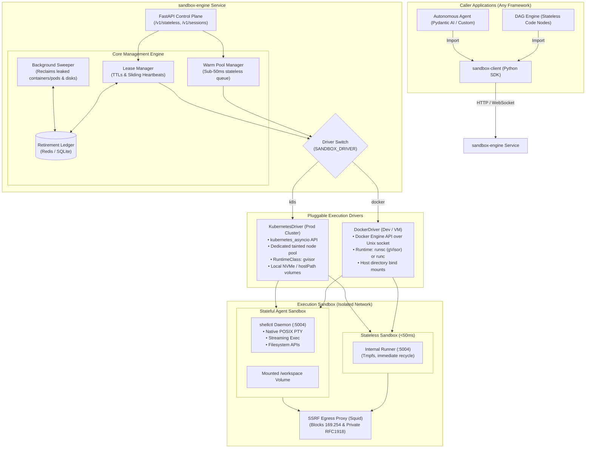

# Sandbox Execution System: Product & Technical Architecture Specification

## 1. Executive Summary

The **Sandbox Execution System** is a high-performance, security-hardened dual-mode execution platform designed to execute both untrusted stateless code and interactive stateful agent sessions.

It provides a unified, decoupled architecture with two primary artifacts:
1. **`sandbox-engine` (The Service / Daemon):** A high-throughput orchestration engine managing container lifecycles, pre-warmed execution pools, session leases, security proxies, and background garbage collection.
2. **`sandbox-client` (The Library / SDK):** A clean, lightweight asynchronous Python SDK (`httpx` + `websockets`) that can be imported by any workflow engine (e.g., DAG code nodes) and autonomous agent frameworks (e.g., Pydantic AI).

The system features a **Pluggable Driver Architecture** that runs identically across **Docker** (local development and single-node servers) and **Kubernetes** (cloud-native production clusters) via a single environment variable toggle: `SANDBOX_DRIVER=docker` or `SANDBOX_DRIVER=k8s`.

---

## 2. System Architecture



---

## 3. Dual Execution Paradigms

### Mode 1: Stateless Code Runner (For DAG Workflow Nodes)
* **Goal:** Sub-50ms execution latency for pure computation tasks.
* **Execution Flow:**
  1. `sandbox-engine` maintains a pre-warmed pool of idle sandboxes in memory.
  2. When a `run_code()` request arrives, a warm container/pod is popped instantly.
  3. Code and input JSON are dispatched directly via **internal HTTP to the container's IP on port 5004** (`http://<ip>:5004/execute`), completely bypassing Docker/Kubernetes API server `exec` overhead.
  4. Execution completes in-memory with tmpfs mounts; output JSON is returned to the caller.
  5. **Replenish-on-Consume:** The consumed container is marked tainted and destroyed asynchronously in the background, while a fresh warm container is immediately spawned to maintain the pool size.

### Mode 2: Stateful OS Sandbox (For Autonomous Agents)
* **Goal:** Persistent, interactive operating system environment for multi-step agent coding (running tests, git commits, package installations, file editing, interactive CLI).
* **Execution Flow:**
  1. Engine mounts a persistent workspace volume: `/data/workspaces/{workspace_id}` $\rightarrow$ `/workspace`.
  2. Container/pod boots with the static **`shellctl` daemon** listening on port `5004`.
  3. A Lease is registered in Redis: `SET lease:session:{session_id} TTL 300`.
  4. A bidirectional WebSocket/PTY stream is opened between the client and `shellctl` for streaming command output (`exec_stream`) and interactive terminal control (`terminal.open()`).
  5. Every interaction refreshes the lease (sliding window). If the agent disconnects or goes idle past the TTL, the background sweeper reclaims the container while keeping the `/workspace` directory intact for future resumption.

---

## 4. Pluggable Driver Architecture (`SANDBOX_DRIVER`)

The system abstracts all container operations behind a standard Python interface:

```python
class ContainerDriver(ABC):
    @abstractmethod
    async def create_sandbox(self, spec: SandboxSpec) -> SandboxInstance:
        """Create and start a new container or Pod."""
        ...

    @abstractmethod
    async def destroy_sandbox(self, sandbox_id: str) -> None:
        """Gracefully stop and remove a sandbox."""
        ...

    @abstractmethod
    async def get_sandbox_endpoint(self, sandbox_id: str) -> str:
        """Return direct internal IP:port (e.g., http://10.244.1.25:5004)."""
        ...

    @abstractmethod
    async def list_sandboxes(self, labels: dict[str, str]) -> list[SandboxSummary]:
        """List managed sandboxes for reconciliation and sweeper GC."""
        ...
```

### 1. `DockerDriver` (Development & Single Host)
* Interacts directly with `/var/run/docker.sock` using async HTTP.
* Uses Docker Bridge network with DNS resolution.
* Supports configurable runtime: `runsc` (gVisor) when available on Linux, with automatic fallback to standard `runc` on macOS Docker Desktop.
* Mounts local host directories for workspace persistence.

### 2. `KubernetesDriver` (Production Cloud-Native Cluster)
* Interacts with Kubernetes API using `kubernetes_asyncio`.
* Runs workloads on a dedicated **Tainted Node Pool** (`sandbox=true:NoSchedule`).
* Pods specify `runtimeClassName: gvisor`.
* **Zero API-Server Bottleneck:** The engine communicates directly with the Pod's internal IP (`http://<pod-ip>:5004`) over the cluster CNI, achieving `<15ms` network dispatch.
* **Instant Storage (0s Mount Latency):** Uses local node NVMe storage (`hostPath` / `local-path-provisioner`) pinned to the sandbox node pool, avoiding the 15–45 second cloud CSI (EBS/GPD) attach/detach delays.

---

## 5. Security & SSRF Hardening

1. **Kernel Isolation (gVisor / `runsc`):**
   * Acts as an application kernel running in userspace.
   * Intercepts and handles untrusted system calls before they ever reach the host Linux kernel, neutralizing root escapes and kernel exploits.
2. **SSRF Egress Firewall (Squid Proxy):**
   * Sandboxes run on an isolated network with direct internet access blocked.
   * All outbound HTTP/HTTPS traffic is routed through the central Squid proxy.
   * **Blocked:**
     * Cloud metadata endpoint: `169.254.169.254`
     * Private RFC-1918 subnets: `10.0.0.0/8`, `172.16.0.0/12`, `192.168.0.0/16`, `127.0.0.0/8`
     * Internal Kubernetes API server: `10.96.0.1`
   * **Allowed:** Configurable domain allowlist (e.g., PyPI, npm, GitHub, Hugging Face).
3. **Container Hardening:**
   * Read-only root filesystem for stateless runners.
   * `automountServiceAccountToken: false` (in Kubernetes).
   * Strict CPU and RAM limits enforced via cgroups v2.

---

## 6. The In-Sandbox Daemon (`shellctl`)

`shellctl` is a lightweight, statically compiled Go binary baked into `/usr/local/bin/shellctl` inside the base sandbox image.

### Why Go over Python?
* **Zero Host Collisions:** Does not interfere with the user's Python packages or virtual environments inside `/workspace`.
* **Resource Footprint:** `<8 MB` RAM overhead and instant startup (`<2ms`).
* **Native PTY Allocation:** Uses `creack/pty` with full `SIGWINCH` window resizing and ANSI escape handling.

### Internal API (`:5004`)
| Endpoint | Method | Purpose |
| :--- | :--- | :--- |
| `/health` | `GET` | Readiness and liveness probe. |
| `/execute` | `POST` | Sub-50ms stateless code runner (JSON in, JSON out). |
| `/exec` | `POST` | Command execution with chunked streaming output. |
| `/ws/pty` | `WebSocket` | Bi-directional interactive terminal (raw PTY). |
| `/fs/read` | `GET` | Stream file contents from `/workspace`. |
| `/fs/write` | `POST` | Upload / write file contents to `/workspace`. |
| `/fs/list` | `GET` | Directory listing with file metadata. |
| `/fs/delete`| `POST` | Delete files or directories. |

---

## 7. Client SDK Interface (`sandbox-client`)

Clean, asynchronous Python package with zero heavy dependencies:

```python
from sandbox_client import SandboxClient

client = SandboxClient(base_url="http://sandbox-engine:8080")

# ==========================================
# 1. Stateless Code Execution (DAG Nodes)
# ==========================================
result = await client.run_code(
    language="python",
    code="""
def main(inputs):
    return {"doubled": inputs["value"] * 2}
""",
    inputs={"value": 21},
    timeout=5.0
)
print(result.output)     # {"doubled": 42}
print(result.duration_ms) # ~35ms

# ==========================================
# 2. Stateful Agent Session (Autonomous Agents)
# ==========================================
async with client.acquire_session(workspace_id="repo_123", ttl_seconds=600) as session:
    # File operations
    await session.fs.write("/workspace/app.py", "print('hello world')")
    
    # Streaming command execution
    async for chunk in session.exec_stream("pytest tests/"):
        print(chunk.text, end="")
        
    # Interactive PTY terminal
    pty = await session.terminal.open(cols=100, rows=30)
    await pty.send("git status\n")
```

---

## 8. Repository Layout

```text
/Users/rishabh/Documents/Code/sandbox-execution-system/
├── product-details.md                 # This specification
├── pyproject.toml                     # Root workspace configuration
│
├── daemon/                            # shellctl (in-container Go daemon)
│   ├── go.mod
│   ├── main.go                        # HTTP + WebSocket PTY server (:5004)
│   ├── executor/                      # Stateless code runner & process exec
│   ├── pty/                           # Native POSIX PTY allocation
│   ├── fs/                            # Filesystem read/write/list operations
│   └── Dockerfile                     # Multi-stage base sandbox image
│
├── sandbox-engine/                    # The Service (FastAPI)
│   ├── pyproject.toml
│   ├── src/sandbox_engine/
│   │   ├── config.py                  # Environment config (SANDBOX_DRIVER, REDIS_URL)
│   │   ├── drivers/
│   │   │   ├── base.py                # Abstract ContainerDriver ABC
│   │   │   ├── docker_driver.py       # Docker Engine API driver
│   │   │   └── k8s_driver.py          # Kubernetes async Pod driver
│   │   ├── core/
│   │   │   ├── warm_pool.py           # Pre-spawned idle container queue
│   │   │   ├── lease_manager.py       # Redis/SQLite lease tracking
│   │   │   └── sweeper.py             # Background GC task
│   │   ├── api/
│   │   │   ├── routes_stateless.py    # POST /v1/stateless/run
│   │   │   ├── routes_sessions.py     # POST /v1/sessions/acquire, release, heartbeat
│   │   │   └── routes_ws.py           # WebSocket proxy to container PTY
│   │   └── main.py                    # Service entrypoint
│   └── tests/
│
├── sandbox-client/                    # The Python SDK
│   ├── pyproject.toml
│   ├── src/sandbox_client/
│   │   ├── client.py                  # SandboxClient entrypoint
│   │   ├── session.py                 # SandboxSession context manager
│   │   ├── fs.py                      # FileSystem client
│   │   ├── terminal.py                # PTY WebSocket client
│   │   └── models.py                  # Pydantic schemas (CodeResult, ExecChunk)
│   └── tests/
│
└── deploy/                            # Deployment Manifests
    ├── docker-compose.yml             # Local dev stack (Engine + Redis + Squid)
    ├── squid/
    │   ├── Dockerfile
    │   └── squid.conf                 # SSRF rules (blocking 169.254, RFC1918)
    └── k8s/                           # Production Kubernetes manifests
        ├── runtimeclass.yaml          # gVisor runtime configuration
        ├── node-pool-taints.yaml      # Node taint & tolerations definition
        ├── networkpolicy.yaml         # Sandboxes namespace egress/ingress lockdown
        ├── engine-deployment.yaml     # sandbox-engine Service & Deployment
        └── squid-deployment.yaml      # Squid proxy deployment
```

---

## 9. Phased Implementation Roadmap

1. **Phase 1: In-Sandbox Daemon (`shellctl`) & Base Docker Image**
   * Write `shellctl` in Go with `/execute`, `/exec`, `/ws/pty`, `/fs`.
   * Create multi-stage `Dockerfile` with Ubuntu, Python 3.11+, Node.js, git, curl, and `shellctl`.
2. **Phase 2: `sandbox-engine` Service & Pluggable Drivers**
   * Implement `ContainerDriver` interface with `DockerDriver` and `KubernetesDriver`.
   * Implement `WarmPoolManager` (<50ms stateless execution over direct IP).
   * Implement FastAPI REST & WebSocket endpoints.
3. **Phase 3: Stateful Leases, Sweeper & SSRF Proxy**
   * Implement `LeaseManager` (Redis with SQLite dev fallback) & sliding heartbeats.
   * Implement `Sweeper` background task (15s reconciliation loop).
   * Build Squid egress proxy configuration with strict SSRF rules.
4. **Phase 4: `sandbox-client` SDK & Integration Testing**
   * Package async Python SDK (`httpx` + `websockets`).
   * Write end-to-end integration test suite verifying both Stateless (<50ms) and Stateful Agent Sessions.
